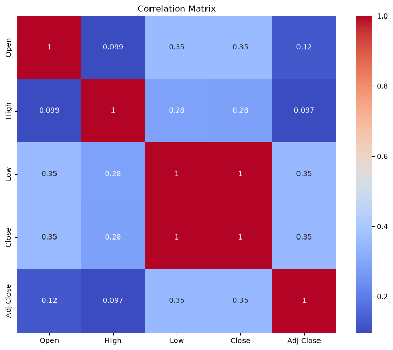
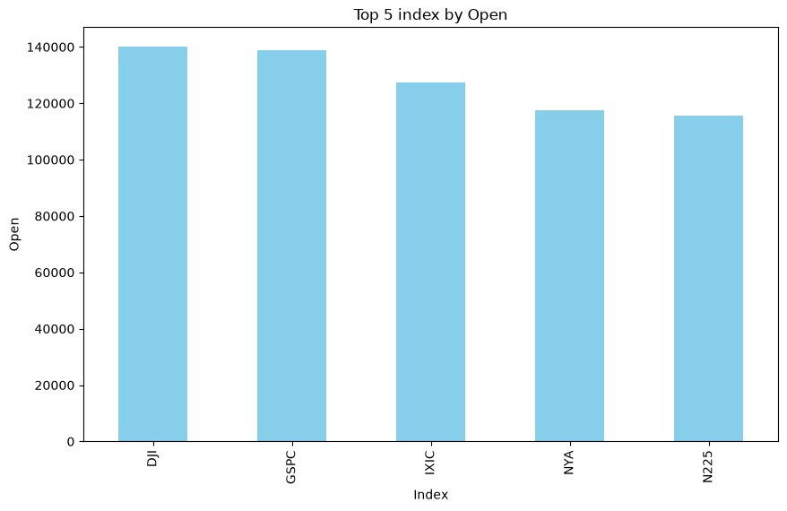
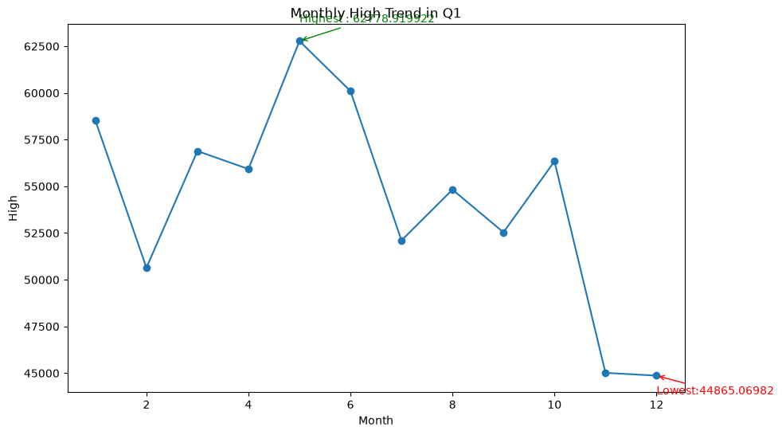
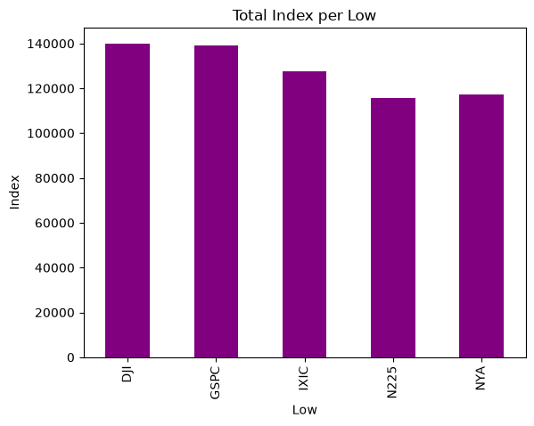
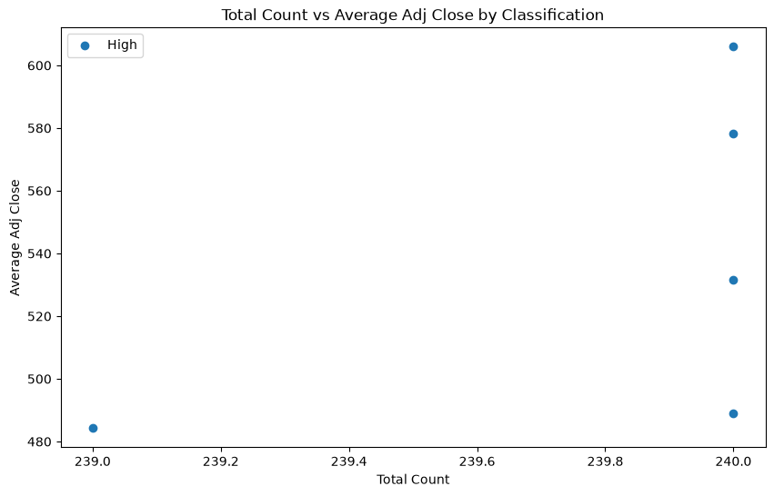

#  Stock Market Data Analysis

Exploratory data analysis (EDA) of historical stock market index data. The full analysis is in `main.ipynb`.

## Table of Contents

- [Objective](#objective)
- [Dataset](#dataset)
- [Data Cleaning](#data-cleaning)
- [Methodology](#methodology)
- [Classification Rules](#classification-rules)
- [Charts](#charts)
- [Results](#results)
- [Insights](#insights)
- [Limitations](#limitations)
- [Future Improvements](#future-improvements)
- [Tech Stack](#tech-stack)
- [Installation](#installation)
- [Project Structure](#project-structure)
- [License](#license)
- [Author](#author)

## Objective

The goal of this project is to explore historical market index data, clean it, and find patterns across indexes and months using summary statistics and visualizations.

## Dataset

File: `Market.csv` (1,199 rows, 1965-12-31 to 1970-11-10)

| Column    | Description              |
|-----------|--------------------------|
| Index     | Name of the market index |
| Date      | Trading date             |
| Open      | Opening price            |
| High      | Highest price of the day |
| Low       | Lowest price of the day  |
| Close     | Closing price            |
| Adj Close | Adjusted closing price   |
| Volume    | Trading volume           |

Indexes in the file: `DJI`, `GSPC`, `IXIC`, `N225`, `NYA`.

## Data Cleaning

| Issue | Columns affected | Fix applied |
|-------|------------------|-------------|
| Missing values | Open (1), High (2), Low (3), Close (4), Adj Close (10), Volume (1) | Filled with the column mean |
| Mixed date formats (`MM/DD/YYYY` and `MM-DD-YYYY`) | Date | Converted to datetime |
| No month/year information | Date | Added `Month` and `Year` columns |
| Duplicate rows | All | Checked and removed (none found, 1,199 rows remained) |

## Methodology

1. **Understand** the data: structure, data types and missing values.
2. **Prepare** the data as described in Data Cleaning.
3. **Explore** with summary statistics and a correlation matrix.
4. **Aggregate** by `Index` and by `Month` to compare totals and averages.
5. **Classify** each index by its average `Adj Close`.
6. **Visualize** the results with bar charts, a line chart, a heatmap and a scatter plot.

## Classification Rules

| Average Adj Close | Class |
|-------------------|-------|
| Above 100 | High |
| Above 50 up to 100 | Medium |
| 50 or below | Low value |

All five indexes fall in the **High** class.

## Charts

### Correlation heatmap


### Total Close per index


### Monthly High trend


### Total Low per index


### Total count vs average Adj Close by classification


## Results

| Index | Total Close | Total Low | Avg Adj Close | Rows |
|-------|-------------|-----------|---------------|------|
| DJI   | 139,979.08  | 139,979.08 | 605.92       | 240  |
| GSPC  | 138,949.56  | 138,949.56 | 578.35       | 240  |
| IXIC  | 127,458.83  | 127,469.62 | 531.59       | 240  |
| NYA   | 117,456.94  | 117,434.40 | 489.11       | 240  |
| N225  | 115,729.66  | 115,729.66 | 484.22       | 239  |

Monthly `High` total is highest in **May** (about 62,779) and lowest in **December** (about 44,865).

## Insights

- `DJI` leads in total `Close` and total `Low`, followed closely by `GSPC`.
- `Low` and `Close` move almost together (correlation about 0.998).
- `Open` and `High` are much more weakly correlated with the other price columns.

## Limitations

- The dataset covers only about five years (1965 to 1970).
- Missing values were filled with the column mean, which can hide real price movement.
- `Volume` is 0 for every row, so it was not used in the analysis.
- Totals (sums of prices) are used only to compare indexes; averages would be more meaningful.
- The classification uses fixed thresholds, so every index ended up in the same class.

## Future Improvements

- Use real data for multiple indexes and a longer time period.
- Add a line chart of daily `Close` price for each index.
- Compare monthly and yearly returns between indexes.
- Fill missing values with forward fill instead of the mean.
- Use quantile-based classification thresholds.

## Tech Stack

- Python 3.14.6
- numpy, pandas, matplotlib, seaborn
- Jupyter notebook / VS Code

## Installation

1. Clone or download the project:
   ```bash
   git clone <your-repository-url>
   cd final_project
   ```
2. Install the required libraries:
   ```bash
   pip install numpy pandas matplotlib seaborn jupyter
   ```
3. Open `main.ipynb` and run all cells from top to bottom.

## Project Structure

```
Stock Market Analysis/
├── main.ipynb
├── Market.csv
├── images/
│   ├── correlation_heatmap.png
│   ├── top_index_close.png
│   ├── monthly_high_trend.png
│   ├── index_low_total.png
│   └── count_vs_adjclose_scatter.png
└── README.md
```

## License

This project is for learning purposes. You are free to use and modify it.

## Author

**Asti Sojitra**
- GitHub: [Asti Sojitra](https://github.com/astisojitra-blip)
